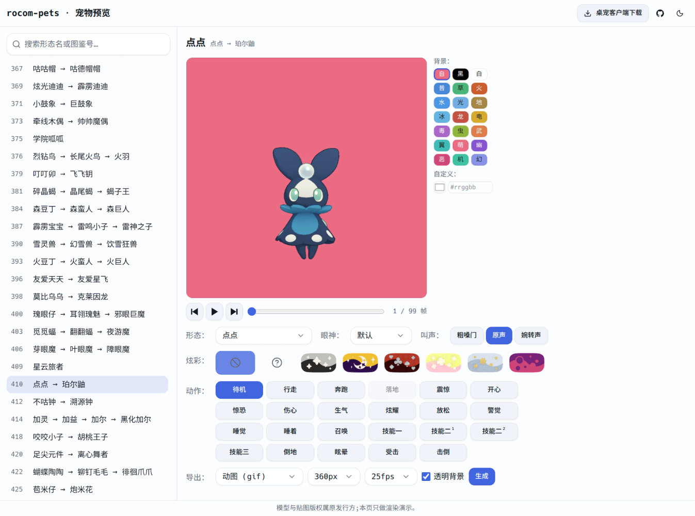
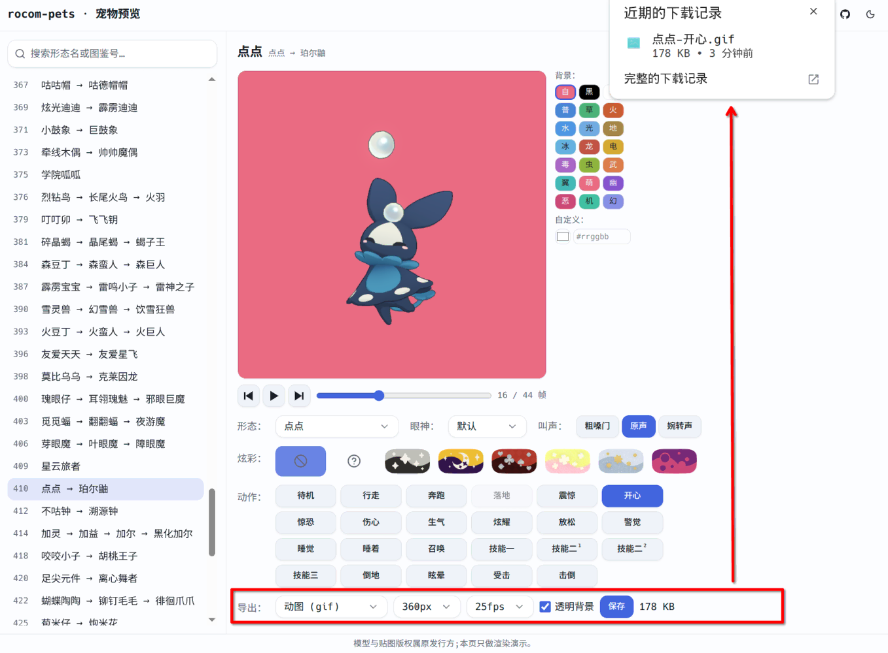
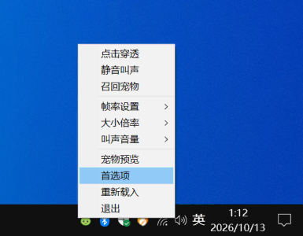
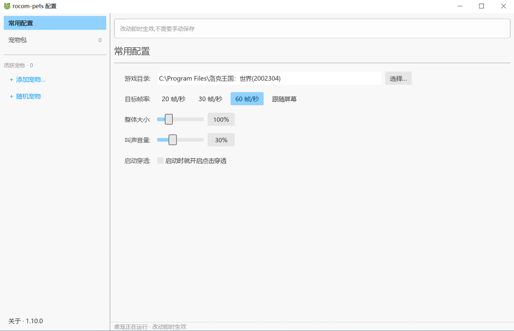
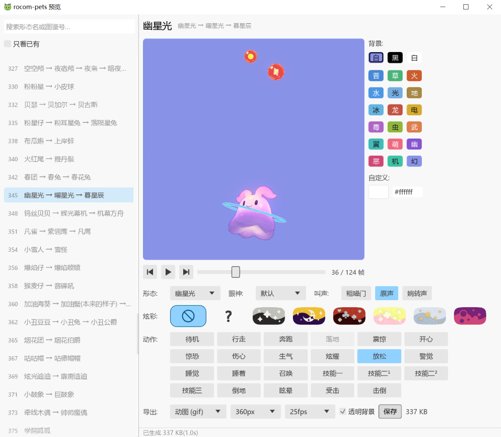

# 洛克王国表情包 GIF 导出教程

在 QQ 群和各个社区中看到的洛克王国精灵 GIF 有的不停闪烁，有的糊成一片，质量实在难以忍受，因此就把自己八月初做的 rkpet 拿出来继续优化，希望能在各个地方看到更多清晰可爱的精灵。

> 部分微信小程序是基于 rkpet 第一版改的，当时的第一版算是开源，但只有 [BWIKI](https://wiki.biligame.com/nrc/%E9%A6%96%E9%A1%B5) 来问过授权。  
> 所以第二版改为闭源；即便闭源，微信小程序 `离愁轩` 仍在盗取 rkpet 的网页资源直接使用。  
> 本项目只有下面列出的网页版和客户端两个入口，没有在其他地方发布过。  

## 网页版

* 浏览器打开 [rkpet.whoisnian.com](https://rkpet.whoisnian.com) 即可，电脑、手机都支持。  
* 电脑上测试过 Chrome，手机上测试过苹果的 Safari 和安卓的 Chrome。其他浏览器显示不出模型或者渲染效果奇怪的话，换成这几个试试。  
* 网站用的是国外的免费服务，国内加载可能比较慢，需要耐心等一会儿。  

### 制作 GIF

1. 在左边列表里找宠物，可以搜名字或图鉴号。手机上宠物列表默认收起，点左上角的按钮展开。
2. 在右边选形态和眼神，部分宠物可以选择异色，炫彩可以自选配色和粒子。
3. 在「动作」里点一个，宠物会循环播放，导出的 GIF 就是选中的动作。
4. 用鼠标或手指旋转、缩放画面，调整后的角度和远近都会对 GIF 生效。
5. 在「导出」那一行，第一个下拉选「动图 (gif)」，再选尺寸、帧率和要不要透明背景。
6. 点「生成」，等进度走完，旁边会显示文件大小，推荐表情包大小在 1M 以下。

## 客户端版

* rkpet 项目最早就是一个桌宠客户端，让宠物在电脑桌面上走来走去，后来加了预览功能，再后来才把预览做成了网页版。主要支持 Windows，需要电脑上安装了游戏，不需要联网。想体验桌宠，或者网页打不开时就可以用客户端。  
* 下载地址只有 [GitHub Release](https://github.com/whoisnian/rocom-pets/releases) 一个，下载名字里带 windows 的 exe 文件后双击运行。客户端会直接读游戏安装目录里的文件获取宠物模型，所以电脑上要装着游戏。  

### 首次启动

1. 运行后，在屏幕右下角的托盘图标上右键选择「首选项」。
2. 在「常用配置」里选择游戏安装目录。
3. 再次右键托盘图标，点「宠物预览」打开预览窗口。

### 制作 GIF

预览窗口和网页版差不多，左边是宠物列表，右边是外观和动作。没导出过的宠物点一下就会从游戏文件里导出来，第一次会稍慢，后面操作就和网页版一样了，「保存」时选个位置就行。

## 导出选项

* 尺寸：64 到 512px，默认 360px。越大越清楚，文件也越大。
* 帧率：20、25、50fps，默认 25fps。越高越顺滑，文件也越大。
* 透明背景：默认勾上。不勾的话用画面右侧选的「背景」颜色铺底。

导出类型里还有其他几种：

* 动图 (webp)：画质无损，但多数聊天软件不支持，发表情包还是用 GIF。
* 静态贴纸：存画面上这一刻的 PNG，需要先拖动进度条停在想要的画面。
* 角色设定图：三视图、表情、配色排成一张图，可以拿去喂给其他 AI 工具进行二创。

## 注意

GIF 太大的话聊天软件不会自动播放，效果就差很多。实测手机 QQ 在 2M 以下、微信在 1M 以下会自动播放。生成后可以先看一眼大小，太大就调低尺寸或帧率重新生成。
